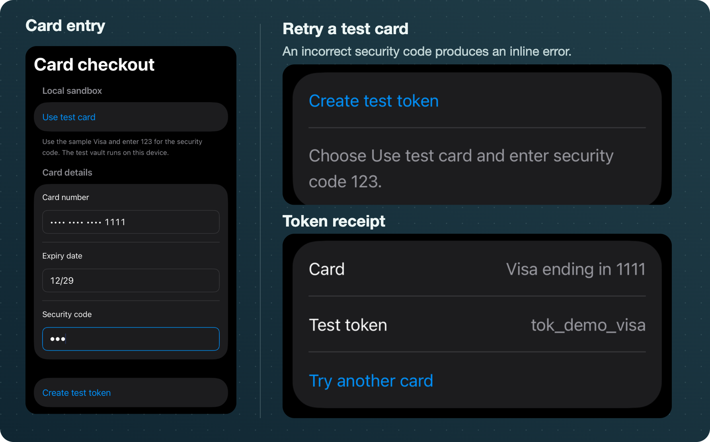
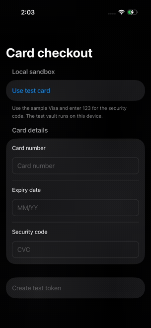
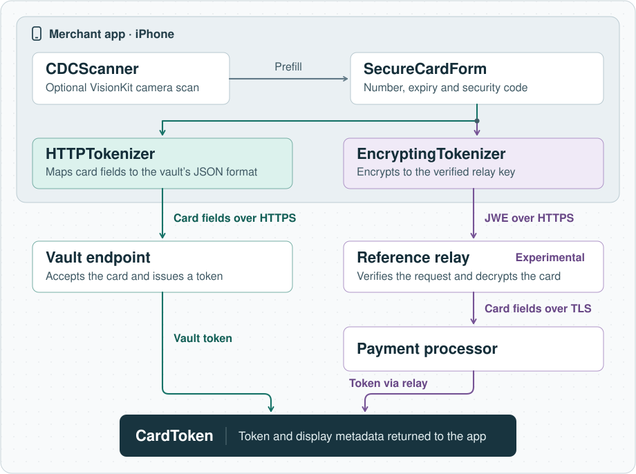

# CDCScanner for iOS

Scan credit and debit cards **fully offline** with the iPhone camera. On-device recognition extracts the card number and optional expiry, with built-in rules for **15 card networks**. Use the scanner on its own, or fill a native SwiftUI or UIKit checkout and send the completed form to your vault for tokenization.

[](https://github.com/Madhurr/CDCScanner-iOS-/actions/workflows/ci.yml) · [Beta release](https://github.com/Madhurr/CDCScanner-iOS-/releases/tag/1.0.0-beta.1) · [Swift Package Index](https://swiftpackageindex.com/Madhurr/CDCScanner-iOS-) · [MIT license](LICENSE)

[](docs/media/checkout-states.png)

[Watch the checkout video](https://github.com/Madhurr/CDCScanner-iOS-/releases/download/1.0.0-beta.1/checkout.mp4) · [Open the example source](Examples/CardCheckout/App) · [See the architecture](#architecture) · [Supported card networks](#supported-card-networks)

## Try the checkout

1. Clone the repository and open [CardCheckout.xcodeproj](Examples/CardCheckout/CardCheckout.xcodeproj) in Xcode.
2. Select the **CardCheckout** scheme, choose an iPhone simulator, and press **Run**. The example uses the local package and needs no API credentials.
3. Tap **Use test card**, enter **123** in **Security code**, and tap **Create test token**. The receipt displays `tok_demo_visa` and **Visa ending in 1111**. To exercise the retry flow, enter a different three-digit code first.

The demo uses the SDK’s fields, validation, JSON request builder, and token parser. An in-process test vault answers the request on the device. Use synthetic card data. The fixture token has no payment value. [Test vault implementation](Examples/CardCheckout/App/TestVault.swift)

<details>
<summary>Play the simulator walkthrough inline</summary>



</details>

## Install the beta

In Xcode, choose **File → Add Package Dependencies**, enter `https://github.com/Madhurr/CDCScanner-iOS-.git`, and select **Exact Version** `1.0.0-beta.1`. In a Swift package manifest, pin the same release.

```swift
.package(url: "https://github.com/Madhurr/CDCScanner-iOS-.git", exact: "1.0.0-beta.1")
```

| Add this product | When you need |
| --- | --- |
| `CDCSecureFields` | Native number, expiry and CVC fields, form validation and tokenization. [Integration guide](docs/SECURE_FIELDS.md) |
| `CDCScanner` | A VisionKit camera scanner returning the number, brand and optional expiry. [Scanner guide](docs/SCANNER.md) |
| `CDCCore` | Card rules, Luhn checks and date parsing without UI. |

The UI targets require iOS 16 or later. The package manifest uses Swift tools 5.9.

## Architecture

Both typed and scanned cards can feed the same `SecureCardForm`. Calling `form.tokenize(using:)` hands the card to the tokenizer you choose. The two paths below show where the card details travel and how the token returns to the app.

[](docs/media/tokenization-architecture.svg)

- **Direct to vault.** `HTTPTokenizer` maps the card fields to your provider’s JSON format and reads the token from a configurable response path. The checkout demo exercises this path with its local test vault. [Secure fields guide](docs/SECURE_FIELDS.md)
- **Experimental encrypted relay.** With the attested key provider, the client verifies the relay’s key and image measurement before encrypting. The Go relay decrypts the payload and forwards card details to the processor. [Protocol and threat model](docs/ZERO_TRUST.md) · [Reference relay](relay/README.md)

## Scan a card on iPhone

On a supported physical iPhone, the example offers **Scan a test card**. VisionKit reads the camera frames on-device. The scanner checks candidate numbers against its bundled brand rules and the Luhn checksum, then confirms the number across frames. It returns the number, brand, and expiry when available. Scanning needs no internet connection or API key. Tokenizing with a remote vault requires a connection. The user enters the security code separately.

Add `NSCameraUsageDescription` to your app’s Info.plist. In a SwiftUI checkout with an attached `SecureCardForm` and an `@State` Boolean named `scanning`, use the scanner modifier on the button.

```swift
Button("Scan a test card") { scanning = true }
    .disabled(!CardScanner.isSupported)
    .cardScanner(isPresented: $scanning) { card in
        form.clear()
        form.numberField?.setNumber(card.number)
        if let expiry = card.expiry {
            form.expiryField?.setExpiry(expiry)
        }
    }
```

Import `CDCScanner` for the scanner modifier and `CDCSecureFields` for the form. UIKit also supports `CardScanner.scan(from:)` with `async/await`. [Device requirements, supported brands, and configuration](docs/SCANNER.md)

<!-- Add the physical-device scanning recording here when available. -->

## Supported card networks

The scanner identifies the network from the card number’s issuer prefix and length. When prefixes overlap, the most specific match wins.

| Card-number length | Networks recognized by the default rules |
| --- | --- |
| 12–19 digits | Maestro |
| 13, 16, or 19 digits | Visa |
| 14–19 digits | Diners Club |
| 15 digits | American Express, UATP |
| 16 digits | Dankort, Mastercard, Mir, NPS Pridnestrovie, RuPay |
| 16–19 digits | Discover, InterPayment, JCB, UnionPay |
| 19 digits | China T-Union |

Set `ScannerConfiguration.brandRules` to limit scanning to the networks your checkout accepts, or add a `CardBrandRule` for a custom issuer range. [Built-in issuer prefixes and lengths](docs/SCANNER.md#supported-brands)

## Connect your vault

Use a provider endpoint intended for native clients that accepts JSON card data and returns a token. The example below uses the default request keys `number`, `exp_month`, `exp_year`, and `cvc`. Configure `HTTPTokenizer.FieldMapping` for other formats. Supply only client-authorized credentials.

```swift
import CDCSecureFields

// form is a SecureCardForm attached to the three fields.
let tokenizer = HTTPTokenizer(
    url: vaultTokenURL,
    headers: ["Authorization": "Bearer " + clientSessionToken],
    tokenPath: "data.id"
)
let token = try await form.tokenize(using: tokenizer)
form.clear()
// Pass token.value to your backend using the provider's payment flow.
```

Endpoint authentication, token permissions and payment authorization belong to the chosen provider. Confirm its sandbox contract before integration. SDK tokenizers discard raw provider response bodies on success and failure. The default session follows redirects only within the original HTTPS origin. A custom session owns its own redirect, trust and storage policies.

## Security and PCI DSS

The fields and their host app share a process. Field state exposes validation and masked details. A custom tokenizer can read the PAN and CVC, and scanning deliberately returns the full number. Exclude these paths from logs, session replay, analytics and crash attachments. After successful tokenization the form clears its CVC field. An integrating app must also clear abandoned forms and control data retained elsewhere.

The optional [encrypted relay](docs/ZERO_TRUST.md) is experimental. Tests exercise JWE interoperability and synthetic attestation fixtures. Real Apple App Attest enrollment, production processor behavior, AWS Nitro hardware and independent security assessment remain open. This beta has no PCI DSS attestation. Determine scope for the actual integration with your acquirer or assessor. [Evidence and limits](SECURITY.md) · [PCI SSC on encryption and scope](https://www.pcisecuritystandards.org/faqs/1086/)

## Run the checks

```sh
swift test -Xswiftc -strict-concurrency=complete -Xswiftc -warnings-as-errors
(cd relay && go test -race ./... && go vet ./... && go build -tags nitro ./...)
```

In the example project, choose **Product → Test** to run the checkout UI test. [Report a security issue privately](https://github.com/Madhurr/CDCScanner-iOS-/security/advisories/new).
