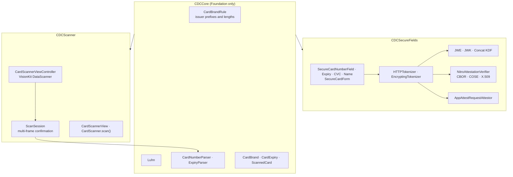
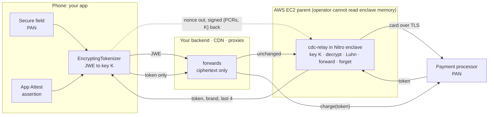
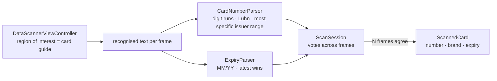

<p align="center">
  <strong>CDCScanner</strong><br>
  Card scanning, hardened card entry and zero-trust tokenisation for iOS.
</p>

<p align="center">
  <a href="https://github.com/Madhurr/CDCScanner-iOS-/actions/workflows/ci.yml"></a>
  <a href="https://swiftpackageindex.com/Madhurr/CDCScanner-iOS-"></a>
  <a href="https://swiftpackageindex.com/Madhurr/CDCScanner-iOS-"></a>
  <a href="LICENSE"></a>
</p>

An open-source alternative to hosted-field SDKs. It reads cards with the camera, collects card
details in fields the host app cannot read, and, in zero-trust mode, encrypts the card number
inside the field to a key the phone has cryptographically verified belongs to a specific
open-source enclave build. No vendor, operator, proxy or merchant server can read the number.
Zero third-party dependencies on iOS, no telemetry, MIT licensed.

| Product | What it is | Reference |
|---|---|---|
| `CDCScanner` | VisionKit camera scanning: number, brand and expiry as typed values | [docs/SCANNER.md](docs/SCANNER.md) |
| `CDCSecureFields` | Hardened entry fields, form, tokenisation transport, zero-trust encryption and attestation | [docs/SECURE_FIELDS.md](docs/SECURE_FIELDS.md), [docs/ZERO_TRUST.md](docs/ZERO_TRUST.md) |
| `CDCCore` | Brand rules, Luhn, parsers; shared by both and usable on its own | source |
| `relay/` | Reference tokenisation relay for AWS Nitro Enclaves (Go) | [relay/README.md](relay/README.md) |

## Contents

- [Architecture](#architecture)
- [Security model](#security-model)
- [Quick start](#quick-start)
- [Requirements and installation](#requirements-and-installation)
- [Verification status](#verification-status)
- [Repository layout](#repository-layout)
- [Contributing](#contributing)
- [License](#license)

## Architecture

### Package layout

Three Swift products share one core. UI products are `#if os(iOS)`; the core and the cryptography
build and test on Linux and macOS as well, which is how the parsing and crypto are exercised on every
push without a device.



### Data flow in zero-trust mode

The card number exists in three places only: the field, enclave memory, and the payment
processor. Everything in between carries ciphertext it has no key for.



Two verifications bracket every payment:

1. **The phone verifies the enclave** before encrypting anything. It fetches an attestation
   document with a fresh nonce, validates the certificate chain to the pinned AWS Nitro root,
   verifies the ES384 signature, and requires the document to be fresh, the nonce to match, and
   PCR0 (the hash of the enclave image) to equal a published release value. Only then does it
   extract the enclave's key. This runs in pure Swift with no platform certificate API.
2. **The enclave verifies the phone** before decrypting anything. Apple App Attest proves the
   request came from a genuine, unmodified build of your app on a real device; a monotonic counter
   defeats replay. This is what stops card-testing scripts.

The full design, cryptographic choices, sequence diagram, threat model and the PCI reasoning are
in [docs/ZERO_TRUST.md](docs/ZERO_TRUST.md).

### Scanning pipeline



A single OCR frame is never trusted. Candidates are Luhn-checked, matched to the most specific
issuer range for their length, and must be read identically on `requiredConfirmations` frames
(default 3) before the card is reported.

## Security model

### What each layer guarantees

| Layer | Guarantee | Mechanism |
|---|---|---|
| Fields | Host code cannot obtain the number | No `text` on the public API; state exposes brand, validity, BIN and last four only |
| Fields | Nothing copies it out | Copy, cut, share, look-up blocked; paste sanitised or disabled; autocorrect and predictive text off |
| Fields | It is not in snapshots or recordings | Covered while the app is inactive and while the screen is captured; screenshot callback |
| Fields | Assistive tech hears a redacted value | VoiceOver reads "Visa ending in 1 1 1 1" |
| `SecureCardData` | It cannot leak through logging or serialisation | Not `Codable`; `description`, `debugDescription`, `dump` and the debugger show the masked number; the PAN is reachable only inside `withNumber { }` |
| `HTTPTokenizer` | Goes only where you point it, over TLS | HTTPS required, no cross-host redirects, ephemeral session, no cache, no cookies |
| `EncryptingTokenizer` | Nobody on the path can read it | JWE (ECDH-ES+A256KW, A256GCM) to verified recipient keys, encrypted before TLS; `typ`, `iat`, `nonce` authenticated in the header |
| `NitroAttestationVerifier` | The key belongs to known code | Chain to pinned AWS root, ES384 signature, PCR pinning, nonce, age, debug-mode refusal |
| `AppAttestRequestAttestor` | Requests come from your real app | Apple App Attest assertion over the body hash with an increasing counter |
| Relay | Decrypts only inside the enclave, stores nothing | Key generated at boot and never exported; nonce replay cache; iat window; Luhn; plaintext zeroed; no card logging |

### Cryptography

| Purpose | Choice |
|---|---|
| Content encryption | AES-256-GCM, 96-bit IV, header as additional authenticated data |
| Key management | ECDH-ES with AES-256 key wrap on P-256; one wrapped content key per recipient, so a single ciphertext can be opened by a relay or a backup processor |
| Attestation signature | ES384 over COSE_Sign1, fixed by AWS Nitro |
| Chain of trust | AWS Nitro Enclaves root G1, SHA-256 `641a0321a3e244efe456463195d606317ed7cdcc3c1756e09893f3c68f79bb5b`, checked in tests against the certificate AWS publishes |
| App integrity | Apple App Attest, ES256, chain to Apple App Attestation Root CA |
| Transport | TLS 1.2+, HTTPS only; pinning via a custom `URLSession` |

### Interoperability checks

The JOSE layer is verified both ways against Python `jwcrypto`. The Go relay decrypts payloads
produced by the Swift SDK. Attestation test fixtures are generated independently with `cbor2` and
`cryptography`, and the pinned AWS root constant is tested against the real certificate.

### What is not claimed

- **Compliance.** A library cannot make an app PCI DSS compliant. PCI SSC FAQ 1086 says
  encryption alone does not remove data from scope; FAQ 1233 says an entity holding only data it
  cannot decrypt may be able to treat it as out of scope. This design is built to meet the second
  statement literally and to show a QSA the code that proves it. Which SAQ applies is the
  acquirer's decision.
- **Memory zeroing on iOS.** Swift strings cannot be zeroed and UIKit retains displayed text.
  The fields minimise copies and lifetime; they do not claim the impossible.
- **Hardware runs.** The relay's enclave path compiles against the Nitro NSM API and runs in dev
  mode with a self-made chain; it has not yet been run inside a real Nitro enclave. App Attest has
  not yet been exercised with a real Apple attestation. No third-party audit has been performed.

See [SECURITY.md](SECURITY.md) for the disclosure policy and
[docs/ZERO_TRUST.md](docs/ZERO_TRUST.md) section 7 for the full threat model.

## Quick start

### Scan a card

```swift
import CDCScanner

let card = try await CardScanner.scan(from: self)
card.formattedNumber   // "4111 1111 1111 1111"
card.brand             // .visa
card.expiry            // 09/27
```

SwiftUI: `.cardScanner(isPresented: $isScanning) { card in … }`. Check `CardScanner.isSupported`
first; VisionKit's live scanner needs an A12 chip or newer and does not run on the simulator.

### Collect a card and tokenise to any HTTPS vault

```swift
import CDCSecureFields

let form = SecureCardForm()
form.attach(numberField: numberField, expiryField: expiryField, cvcField: cvcField)

let tokenizer = HTTPTokenizer(
    url: URL(string: "https://vault.example.com/v1/tokens")!,
    headers: ["Authorization": "Bearer pk_live_…"],
    mapping: .init(number: "card.number", expiryMonth: "card.exp_month",
                   expiryYear: "card.exp_year", securityCode: "card.cvc"),
    tokenPath: "data.id"
)
let token = try await form.tokenize(using: tokenizer)   // your code never sees the PAN
```

### Zero-trust mode

```swift
let policy = NitroAttestationPolicy(expectedPCRs: [0: [relayReleasePCR0]])
let enclave = AttestedEnclaveKeyProvider(url: URL(string: "https://relay.example.com/v1/attestation")!, policy: policy)

let tokenizer = EncryptingTokenizer(
    url: URL(string: "https://relay.example.com/v1/tokenize")!,
    recipients: enclave,
    attestor: AppAttestRequestAttestor()
)
let token = try await form.tokenize(using: tokenizer)
```

Run the relay locally with `cd relay && go run ./cmd/relay`; dev mode produces attestation
documents from a self-made chain so the whole flow, including PCR pinning, works on a laptop.

## Requirements and installation

| Requirement | Minimum |
|---|---|
| iOS | 16.0 |
| Swift / Xcode | Swift 5.9, Xcode 15 |
| Camera scanning hardware | A12 Bionic or newer; not available on the simulator |
| App Attest | Physical device; not available on the simulator |
| Info.plist | `NSCameraUsageDescription` when using `CDCScanner` |

```swift
dependencies: [
    .package(url: "https://github.com/Madhurr/CDCScanner-iOS-.git", from: "1.0.0")
],
targets: [
    .target(name: "YourApp", dependencies: [
        .product(name: "CDCScanner", package: "CDCScanner-iOS-"),
        .product(name: "CDCSecureFields", package: "CDCScanner-iOS-"),
    ])
]
```

Both UI products re-export `CDCCore`. On Apple platforms there are no third-party dependencies;
Apple's open-source `swift-crypto` is linked only when building on Linux, for tests.

## Verification status

| Area | Verified | How |
|---|---|---|
| Parsing, brand rules, Luhn, expiry | Yes | Unit tests on Linux, macOS, iOS Simulator |
| Field formatting, state, CVC and expiry rules | Yes | Unit tests |
| JWE encryption and decryption | Yes | Round trips; jwcrypto both ways; go-jose decrypts Swift output |
| Nitro attestation verification | Yes | Independently generated documents: genuine, tampered, foreign root, wrong PCR, debug mode, stale, expired leaf |
| AWS root pin | Yes | Constant compared with the published certificate |
| Relay HTTP flow | Yes | End-to-end test with replay, expiry and garbage rejection |
| App Attest verification logic | Partly | Synthetic chain in Go; not yet a real Apple attestation |
| Relay inside a real Nitro enclave | No | Builds with `-tags nitro`; first hardware run pending |
| UIKit field behaviour on a device | No | Compiles on iOS Simulator in CI; hands-on pass pending |
| Third-party audit | No | Planned; see SECURITY.md |

Every push runs three CI jobs: iOS Simulator build and tests, macOS tests under strict
concurrency with warnings as errors, and the Go relay with `gofmt`, `go vet`, the `nitro` build
tag and tests.

## Repository layout

```
Sources/
  CDCCore/            brand rules, Luhn, parsers, result types
  CDCScanner/         VisionKit scanner, ScanSession, SwiftUI wrapper
  CDCSecureFields/
    UIKit/            SecureField base, number/expiry/CVC/name fields, SecureCardForm
    SwiftUI/          UIViewRepresentable wrappers
    Core/             formatter, states, SecureCardData, CardTokenizer, HTTPTokenizer
    Crypto/           JWE, JWK, Concat KDF, base64url
    Attestation/      CBOR, COSE_Sign1, minimal X.509, Nitro verifier, AWS root
    ZeroTrust/        EncryptingTokenizer, key providers, App Attest attestor
Tests/                one test target per product, 107 tests
relay/                Go reference relay: attestation, JWE decrypt, App Attest, PSP adapters
docs/                 SCANNER.md, SECURE_FIELDS.md, ZERO_TRUST.md
```

## Contributing

Issues and pull requests are welcome. Please add a test for any change to parsing, brand rules,
cryptography or attestation, and read [SECURITY.md](SECURITY.md) before reporting a
vulnerability.

```bash
swift test                                   # core, fields, crypto, attestation on any platform
xcodebuild test -scheme CDCScanner-Package \
  -destination 'platform=iOS Simulator,name=iPhone 16'
cd relay && go test ./...
```

Built and maintained by [Madhur Jain](https://github.com/Madhurr).

## License

MIT. See [LICENSE](LICENSE).
